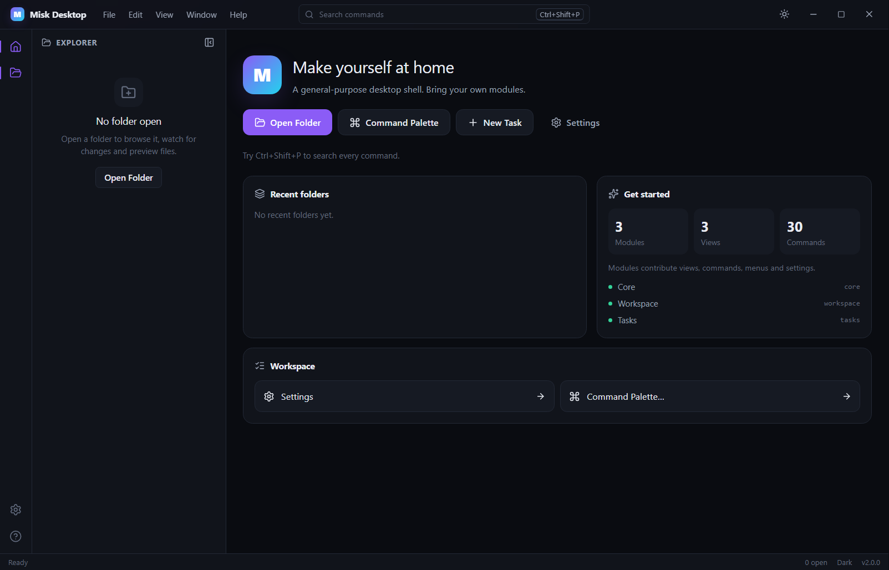
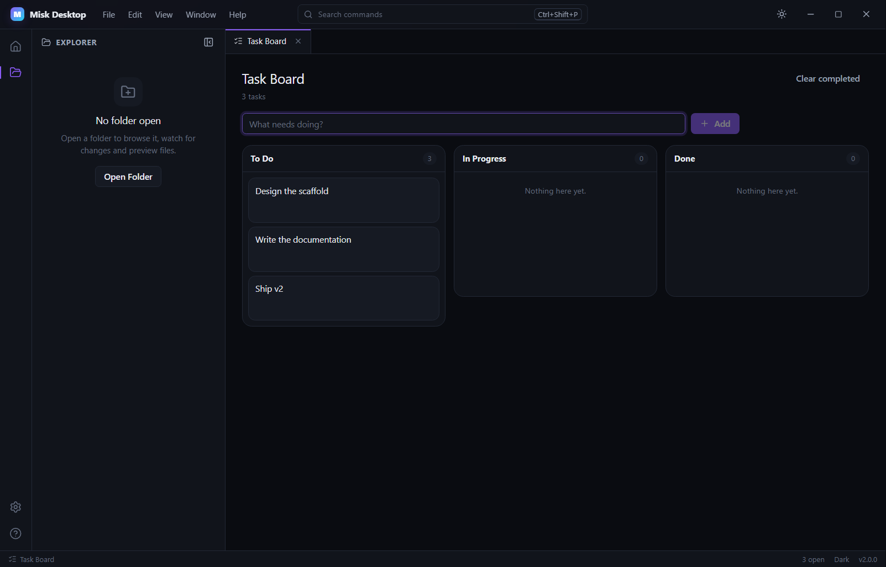

# Misk Desktop

**通用桌面壳脚手架**。基于 Electron + React + TypeScript，提供一套不绑定编辑器、可承载任意桌面应用的壳：窗口、工作台、路由、标签、命令、菜单、设置、主题、i18n、文件、工作区、日志与安全边界。

业务以**构建期模块**接入；仓库附带生成器、非编辑器示例（Tasks 看板）、测试与发布流水线。



## 它是什么

- **壳**：自绘标题栏、活动栏、侧边栏、标签页、状态栏、命令面板、快速切换、菜单、对话框、通知。
- **基础设施**：模块注册表、类型安全 IPC、设置持久化、主题、i18n、日志、崩溃兜底、诊断导出。
- **桌面能力**：单实例、`misk://` 深链、窗口状态恢复、原生菜单 + 应用内菜单、系统通知、最近工作区、文件监听、拖放、文件预览。
- **脚手架**：`gen:module` / `gen:view` / `gen:panel` / `gen:settings`、`rename-app`、`eject-demo`。
- **不是**：编辑器、Markdown 工具、UI 组件库、运行时插件市场。

## 快速开始

要求 Node.js ≥ 22.12、npm ≥ 10。

```bash
npm install
npm run dev
```

国内网络如果 Electron 下载慢：

```powershell
$env:ELECTRON_MIRROR="https://npmmirror.com/mirrors/electron/"
npm install
```

首次启动进入 Home；点 **Open Folder** 打开工作区，点 **New Task** 看示例模块。



## 脚本

| 命令 | 说明 |
| --- | --- |
| `npm run dev` | Electron + Vite 开发（HMR） |
| `npm run build` | 类型检查 + 构建 main / preload / renderer |
| `npm run start` | 预览构建产物 |
| `npm run typecheck` | TypeScript 检查 |
| `npm run lint` / `npm run format` | Biome 检查 / 格式化 |
| `npm test` / `npm run test:coverage` | Vitest 单测 + 覆盖率 |
| `npm run e2e` | Playwright Electron 端到端 |
| `npm run verify` | lint + typecheck + coverage + build |
| `npm run package:win` | Windows NSIS + portable |
| `npm run package:mac` / `package:linux` | macOS dmg/zip、Linux AppImage/deb |
| `npm run gen:module -- notes` | 生成模块 |
| `npm run gen:view -- notes.detail` | 生成视图 |
| `npm run rename-app -- --name "Acme" --id com.acme.app --protocol acme` | 改名 |

## 目录

```text
src/
├─ main/          Electron 主进程：窗口、协议、菜单、通知、日志、IPC、服务
├─ preload/       contextBridge 暴露的 window.misk
├─ shared/        IPC 契约、设置 schema、快捷键、MIME
└─ renderer/src/
   ├─ shell/      通用壳：布局、路由、浮层、主题、UI
   ├─ core/       注册表、命令、菜单、设置、路由、i18n、存储
   └─ modules/    core、workspace、tasks
scripts/          生成器、改名、eject、安装辅助
tests/            unit / component / e2e / fixtures
docs/             架构、模块、IPC、设置、工作区、发布、FAQ
```

## 10 分钟接入第一个模块

```bash
npm run gen:module -- notes
```

生成 `src/renderer/src/modules/notes/`，并自动注册到 `modules/index.ts`。打开
`src/renderer/src/modules/notes/NotesView.tsx` 写内容，运行 `npm run dev`，在命令面板执行
**Open Notes** 即可。

模块的唯一入口是 `defineModule`：

```ts
export const notesModule = defineModule({
  id: 'notes',
  name: { key: 'module.notes.name', ns: 'notes' },
  activate: (ctx) => {
    ctx.views.register({ id: 'notes.main', title: { key: 'notes.main.title', ns: 'notes' }, component: NotesView })
    ctx.commands.register({
      id: 'notes.open',
      title: { key: 'notes.open', ns: 'notes' },
      run: (runtime) => runtime.openView('notes.main')
    })
    ctx.menus.add('view', { command: 'notes.open', order: 80 })
  }
})
```

`ctx` 还提供 `commands`、`panels`、`status`、`settings`、`menus`、`home`、`i18n`、`notifications`、`logger`、`app`。
完整说明见 [模块](docs/modules.md)。

## 快捷键

| 操作 | 快捷键 |
| --- | --- |
| 命令面板 | `Mod+Shift+P` |
| 快速切换（文件/视图） | `Mod+P` |
| 打开文件夹 | `Mod+Shift+O` |
| 关闭标签 | `Mod+W` |
| 下一个 / 上一个标签 | `Ctrl+Tab` / `Ctrl+Shift+Tab` |
| Home | `Mod+Shift+H` |
| 设置 | `Mod+,` |
| 快捷键帮助 | `F1` |
| 新建任务（示例） | `Mod+Alt+N` |

`Mod` 在 Windows/Linux 是 Ctrl，在 macOS 是 Cmd。所有绑定可在 **Settings → Keyboard shortcuts** 修改。

## 安全

- `sandbox: true`、`contextIsolation: true`、`nodeIntegration: false`。
- 生产页面通过 `app://` 自定义协议加载，CSP 由主进程注入。
- IPC 全部走 zod 校验 + sender 校验 + 统一错误信封。
- 渲染进程不接收绝对路径读写：文件走 opaque handle，工作区走 root + 相对路径，并做 `..`/符号链接逃逸检查。
- 深链只导航 View，不携带文件路径。
- 详见 [SECURITY.md](SECURITY.md)。

## 没有内置什么

托盘、全局快捷键、多窗口、自动更新、运行时插件、远程崩溃上报、遥测、分屏/停靠、文档编辑器生命周期。
这些是**有意不做**，在 [桌面能力](docs/desktop.md) 中给出接入位置与做法。

## 文档

- [架构](docs/architecture.md)
- [模块](docs/modules.md)
- [View / 路由 / 标签](docs/views-router.md)
- [命令 / 快捷键 / 菜单](docs/commands-keybindings.md)
- [IPC](docs/ipc.md)
- [设置](docs/settings.md)
- [工作区](docs/workspace.md)
- [桌面能力](docs/desktop.md)
- [主题](docs/theming.md) · [多语言](docs/i18n.md)
- [生成器](docs/generators.md) · [测试](docs/testing.md) · [发布](docs/release.md)
- [FAQ](docs/faq.md)

## English summary

Misk Desktop is a general-purpose Electron desktop shell scaffold. It ships the window chrome,
routing, tabs, commands, menus, settings, themes, i18n, file/workspace access, logging and security
boundaries, while leaving business features to build-time modules. Clone it, run the generator, and
start writing your app.

## License

[MIT](LICENSE)
